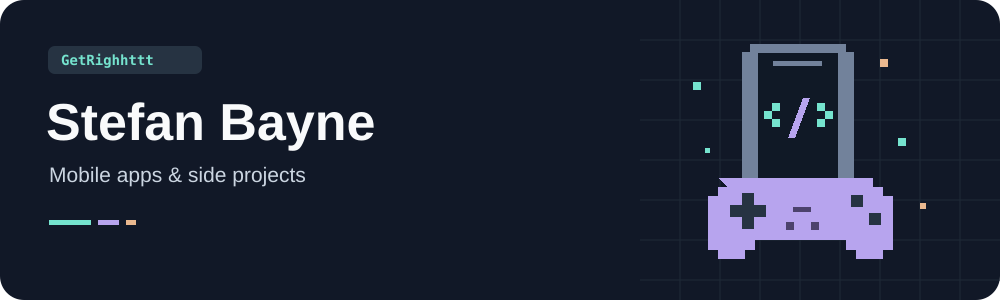

  

# Hey, I'm Stefan

I'm a Senior Mobile Engineer, mostly working in Android. I also spend time with
iOS, Flutter, and Kotlin Multiplatform.

I like building apps and figuring out why things work the way they do. A lot of
my work involves coming back to older code, making sense of it, and making it
easier to work with. Lately, I've been working with Compose Multiplatform and
trying out AI tools in my development workflow.

[Email](mailto:stefanbusiness95@gmail.com) · [GitHub](https://github.com/GetRighhttt)

## What's on here

A mix of personal projects, course work, and things I've built to teach myself.
Some repos started with one thing I wanted to understand. Others became apps I
kept adding to.

I've come back to a lot of these projects over the years. Sometimes I update
them, sometimes I realize I understand something differently now. The history
is part of why I like keeping them around.

I've also been cleaning them up so they're easier to revisit and easier for
someone else to run.

## A few projects

### [Recipe Compose](https://github.com/GetRighhttt/RecipeCompose)

Started as a way to learn Jetpack Compose and grew into a recipe app for Android
and iOS. I've used it to explore Compose Multiplatform, saving recipes, and
finding nearby places to eat.

### [MVVM 2026](https://github.com/GetRighhttt/Stefan-Mvvm-2026)

A small Android reference with the same login screen built in XML and Compose.
Both use the same ViewModel, so I can compare the UI approaches and work through
where state and app logic belong.

### [Coroutines](https://github.com/GetRighhttt/Coroutines)

My notes and runnable examples for Kotlin coroutines and Flow. I use small
examples to work through suspension, cancellation, and other behavior that's
easy to misread.

### [Rick and Morty Android MVVM](https://github.com/GetRighhttt/RickAndMortyAndroidMVVM)

One of the first Android apps I built on my own. I've come back to it over the
years to update the UI and rethink parts of the code as I learned more.

### [Kotlin](https://github.com/GetRighhttt/Kotlin)

I made this one to remember syntax, then barely revisited it for a while.
I've learned Kotlin a few times at this point. It's now a collection of examples
and notes I can come back to, with the earlier attempts still in the commit
history.

[Browse all public repositories](https://github.com/GetRighhttt?tab=repositories)

## What I work with

Android is where I'm most comfortable. These are some of the languages and tools
I work with or have explored in my repos.

### Languages

### Mobile and tools

## Courses and certificates

- AWS: [View credential](https://user-images.githubusercontent.com/105057858/181920769-8e6a66aa-4b49-40b1-ac81-89db3063aada.png)
- Working with Data - Coursera: [View certificate](https://github.com/user-attachments/files/18231044/Working_With_Data.pdf)
- Advanced Kotlin - Coursera: [View certificate](https://github.com/user-attachments/files/18231045/Advanced_Kotlin.pdf)
- Version Control - Coursera: [View certificate](https://github.com/user-attachments/files/18231048/Version_Control.pdf)
- Kotlin Coroutines & Flows Masterclass - Philipp Lackner: [View certificate](https://files.mspotcdn.de/schools%2FNRYaO8KduDTG8m2REJmk%2FuserData%2FDuuDl4lBCRNwF4d18vp7qyI4Uo92%2F1736378298567_YsfmBAvp1IqBKd23MzHg.pdf?alt=media&token=dbab04fa-c534-4ff5-92d9-5cbf19ef1c73)
- Android Internals - Philipp Lackner: [View certificate](https://files.mspotcdn.de/schools%2FNRYaO8KduDTG8m2REJmk%2FuserData%2FDuuDl4lBCRNwF4d18vp7qyI4Uo92%2F1745013500352_VnwdjgXNctjeQtmYUdHeh.pdf?alt=media&token=228c8d98-8baf-4d29-9610-c5cce34dd663)
- Professional App Development With CI/CD - Philipp Lackner: [View certificate](https://files.mspotcdn.de/schools%2FNRYaO8KduDTG8m2REJmk%2FuserData%2FDuuDl4lBCRNwF4d18vp7qyI4Uo92%2F1757683218170_2/FPpyw5W1tp9VjiyTM4v.pdf?alt=media&token=afd7458a-879a-456b-8426-9475818d013f)

## Say hello

I'm happy to talk about Android, Kotlin, or something you're working on.
You can reach me at [stefanbusiness95@gmail.com](mailto:stefanbusiness95@gmail.com).

"GetRighhttt" was my Fortnite handle in college. It ended up following me into
software development.

  

